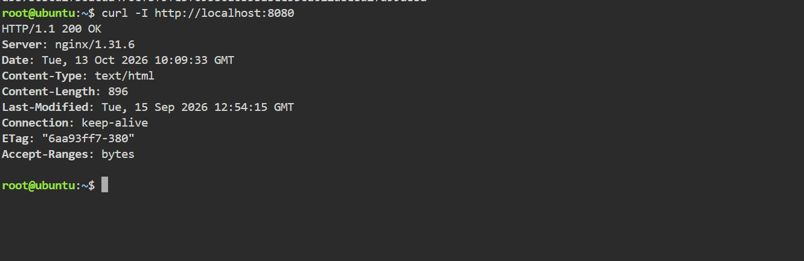
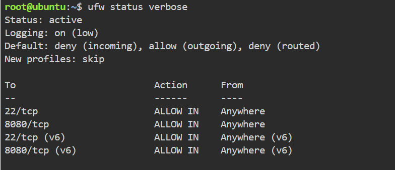
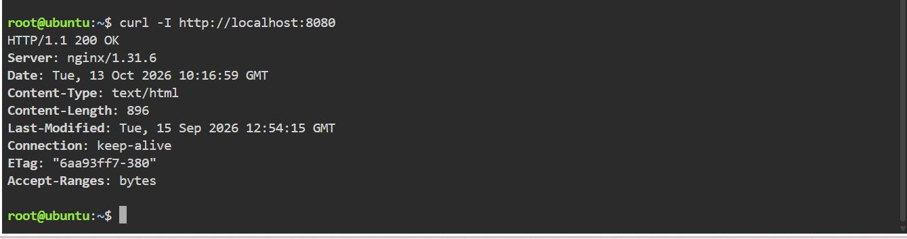

# Laboratory Activity 08: The Cloud Security Engineer

**Student Name:** Anthony Cabading  
**Course:** CCM101 – Cloud Computing  
**Environment:** KillerCoda Ubuntu 24.04  
**Tools Used:** Docker, Nginx, UFW, cURL, and GitHub

## Mission Overview

This laboratory focuses on implementing fundamental cloud security practices by deploying a web application, configuring firewall rules, and verifying network accessibility.

As a Cloud Security Engineer, the primary responsibility is to protect cloud infrastructure by restricting unnecessary network access while maintaining the availability of authorized services.

## Learning Objectives

- Understand the Principle of Least Privilege (PoLP).
- Identify potential attack surfaces in cloud environments.
- Apply a Default Deny firewall policy.
- Configure UFW to allow authorized network traffic.
- Deploy and test an Nginx application using Docker.
- Document security configurations and testing results.

## Checkpoint 1: Security Research

Studied three important cloud security concepts:

**Principle of Least Privilege:** Limits permissions to only what is necessary.

**Attack Surface:** Represents potential entry points that attackers may attempt to exploit.

**Default Deny Policy:** Blocks incoming connections unless explicitly authorized.

Detailed discussion: [Security Audit Report](security-audit-report.md)

## Checkpoint 2: Deploy the Web Application

The Nginx application was deployed using Docker.

```bash
docker run -d --name secure-web-app -p 8080:80 nginx
```

Application connectivity was tested using:

```bash
curl -I http://localhost:8080
```

**Observed Result:** HTTP/1.1 200 OK

## Checkpoint 3: Configure UFW Firewall

The following commands were executed:

```bash
ufw status verbose
ufw allow 22/tcp
ufw default deny incoming
ufw default allow outgoing
ufw allow 8080/tcp
ufw show added
ufw enable
ufw status verbose
```

### Verified Firewall Configuration

| Setting | Result |
|---|---|
| Firewall Status | Active |
| Incoming Policy | Deny |
| Outgoing Policy | Allow |
| Routed Policy | Deny |
| SSH Port 22 | Allow |
| Application Port 8080 | Allow |
| Firewall Logging | On (low) |

Detailed documentation: [Firewall Configuration Report](firewall-configuration.md)

## Checkpoint 4: Security Verification

After enabling UFW, the Nginx application was tested again.

```bash
curl -I http://localhost:8080
```

**Observed Result:** HTTP/1.1 200 OK

The application remained accessible locally after firewall activation.

**Security Note:** Docker-published ports may bypass some UFW rules. External network testing would be required to confirm effective traffic restrictions.

## Screenshot Evidence

The following screenshots document the laboratory activities.

### 1. Nginx Application Running



### 2. Firewall Activated



### 3. Application Allowed Through Firewall



*Screenshot images will appear after the evidence files are uploaded.*

## Laboratory Files

| File | Description |
|---|---|
| `README.md` | Laboratory overview and results |
| `security-audit-report.md` | Security principles and best practices |
| `firewall-configuration.md` | UFW commands and verification |
| `reflection.md` | Personal learning reflection |
| `screenshots/` | Terminal evidence |

## Reflection

This activity demonstrated how firewall rules can be used to manage network access in a cloud environment. It also emphasized the importance of verifying security configurations after making changes.

Read the complete reflection: [Reflection Report](reflection.md)

## Conclusion

Laboratory Activity 08 provided practical experience in deploying a containerized web application and configuring a Linux firewall. UFW was successfully enabled with a Default Deny incoming policy, and the Nginx application remained accessible through local testing.

The laboratory reinforced the importance of security planning, controlled access, and continuous verification in cloud infrastructure management.
