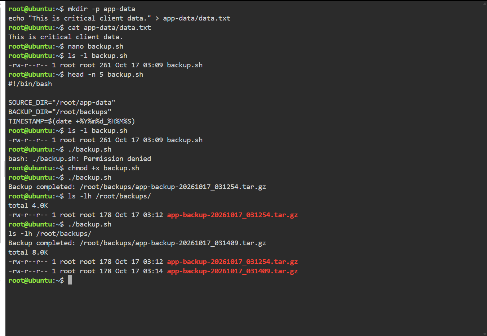
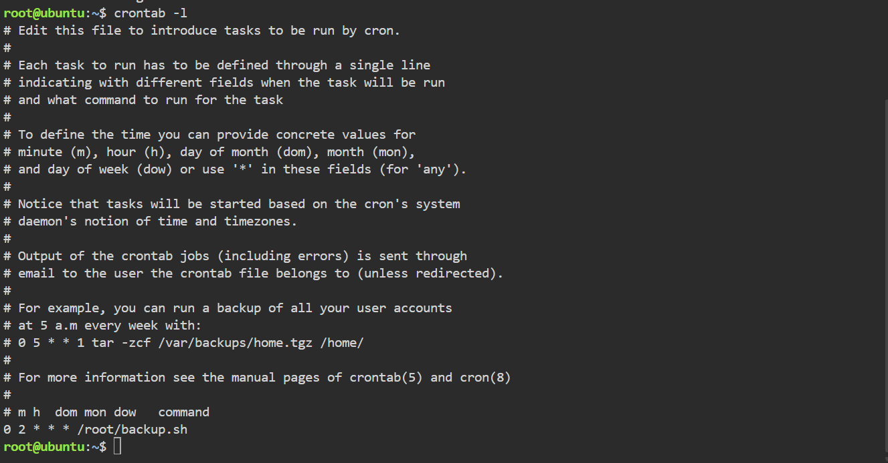

# Laboratory 09 – Automated Backup Script Guide

**Student:** Anthony Cabading  
**Course:** CCM101 – Cloud Computing  
**Mission:** The Cloud Automation Engineer

## Overview

This guide documents the creation and testing of a Bash script that produces timestamped backups of application data. It also explains the Linux commands used to execute the script and the Cron schedule configured for daily backups.

## 1. Preparing the Application Data

The following commands were used to create sample application data:

```bash
mkdir -p app-data
echo "This is critical client data." > app-data/data.txt
```

The `app-data` directory served as the source of the files included in each backup.

## 2. Creating the Backup Script

The script was created using:

```bash
nano backup.sh
```

The following Bash script was tested in the Ubuntu environment:

```bash
#!/bin/bash

SOURCE_DIR="/root/app-data"
BACKUP_DIR="/root/backups"
TIMESTAMP=$(date +%Y%m%d_%H%M%S)
BACKUP_FILE="$BACKUP_DIR/app-backup-$TIMESTAMP.tar.gz"

mkdir -p "$BACKUP_DIR"
tar -czf "$BACKUP_FILE" -C /root app-data

echo "Backup completed: $BACKUP_FILE"
```

### Explanation of the Script

- `#!/bin/bash` specifies the Bash interpreter.
- `SOURCE_DIR` stores the source directory path for reference.
- `BACKUP_DIR` identifies where backup archives will be stored.
- `TIMESTAMP` records the current date and time for unique backup filenames.
- `BACKUP_FILE` combines the backup location, filename, and timestamp.
- `mkdir -p` creates the backup directory if it does not exist.
- `tar -czf` compresses the application directory into a `.tar.gz` archive.
- `echo` displays a message after the backup command finishes.

## 3. Setting Executable Permissions

Before the script was given executable permission, running the command below resulted in a permission error:

```bash
./backup.sh
```

To allow direct execution, the following command was used:

```bash
chmod +x backup.sh
```

The `chmod +x` command adds executable permission to the script. Afterward, the script could be launched using `./backup.sh`.

## 4. Running and Verifying the Backup

The following commands were used:

```bash
./backup.sh
ls -lh /root/backups/
```

The script reported that the backup was completed, and the directory listing confirmed the presence of timestamped `.tar.gz` files.

The screenshot below shows the successful execution and generated backup files.



## 5. Scheduling Automatic Backups Using Cron

The Cron editor was opened using:

```bash
env EDITOR=nano crontab -e
```

The following entry was added:

```cron
0 2 * * * /root/backup.sh
```

### Understanding the Cron Expression

| Field | Value | Meaning |
|---|---|---|
| Minute | `0` | At minute zero |
| Hour | `2` | At 2:00 AM |
| Day of Month | `*` | Every day of the month |
| Month | `*` | Every month |
| Day of Week | `*` | Every day of the week |

This schedule is configured to execute the backup script daily at 2:00 AM based on the server's time zone.

The configuration was verified using:

```bash
crontab -l
```

The verification confirmed that the Cron entry was saved. It did not independently confirm that the scheduled job had already executed.



## 6. Benefits of Backup Automation

Automated backups reduce the need to perform repetitive tasks manually. They also support consistent backup scheduling and help administrators maintain copies of important application files.

For production systems, backup scripts should include error handling, storage monitoring, retention policies, and periodic recovery testing.

## Conclusion

This laboratory demonstrated how Bash scripting and Cron scheduling can support routine cloud administration. The backup script successfully created compressed archives, while the Cron configuration established a schedule for daily execution.
